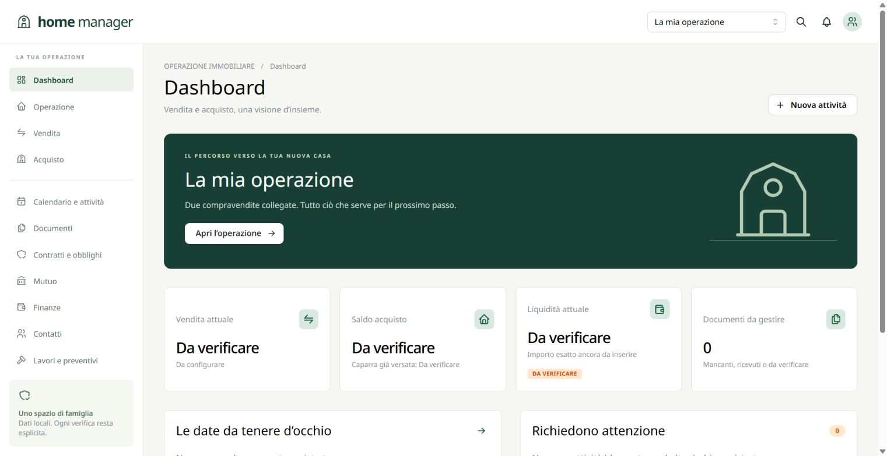

# home manager

Gestionale familiare locale per coordinare vendita e acquisto di casa. React e TypeScript strict, Mantine **9.7.4**, Vite, Fastify e SQLite. Versione **0.3.0**, da validare sul dispositivo Home Assistant. L’interfaccia usa Noto Sans, incluso nell’app per l’uso offline.

Il packaging Home Assistant richiede il collaudo sull’installazione reale.



## Avvio locale

Servono Node.js 24 e npm compatibile con la versione di Node installata.

```powershell
cd home-manager
npm ci
npm run dev
```

Aprire **http://127.0.0.1:5178**. Vite inoltra le API al backend su `127.0.0.1:3088`. Per provare il pacchetto di produzione:

```powershell
npm run build
npm start
```

Aprire **http://127.0.0.1:3088**. Database e file sono in `./data`. Le prove di sviluppo possono usare un percorso diverso tramite `DATA_DIR`. I dati di prova automatizzati usano cartelle temporanee isolate.

Al primo avvio viene creata soltanto un’operazione vuota con stati di transazione e promemoria predefiniti. Non sono precompilati nomi, immobili, prezzi, date contrattuali o scenari finanziari. I dati si inseriscono dall’interfaccia oppure si recuperano tramite backup. Le installazioni esistenti non vengono modificate dal cambio della configurazione iniziale.

I dati iniziali risiedono in [initial-data.json](initial-data.json), separati dalla logica applicativa. Si può modificarli prima del primo avvio oppure indicare un altro file con `INITIAL_DATA_FILE`. I riferimenti `@chiave` collegano record importati in ordine; ogni importazione viene validata e applicata in un’unica transazione. Per un database già inizializzato usare i moduli dell’interfaccia: il file non sovrascrive modifiche salvate.

## Home Assistant OS

L’installazione dichiarata è **Home Assistant OS con add-on**. Il packaging usa: container Node 24 unico, frontend servito dal backend, Ingress, percorsi relativi e persistenza in `/data`.

Questo repository è già la cartella dell’add-on: contiene `config.yaml` e `Dockerfile` alla radice. Per una prima installazione **locale**, copiare il sorgente in `/addons/casa_manager` sul sistema Home Assistant, escludendo `.git`, `node_modules`, `dist`, `.env`, `data`, `backups` e `.local`. Ricaricare lo store degli add-on, aprire **home manager**, installare, avviare e aprire l’interfaccia web. Non è necessario configurare credenziali o token Home Assistant.

La porta **8104 è solo interna**; non è pubblicata sull’host. Il server accetta richieste applicative esclusivamente dal proxy Ingress del Supervisor (`172.30.32.2`), con health check separato. L’add-on non chiede accesso alle API HA, rete host, dispositivi o cartelle condivise. I dati in `/data` sono persistenti e il backup Supervisor è configurato `cold` per acquisire database e file ad applicazione arrestata.

Per l’installazione tramite repository remoto, usare l’URL del proprio repository di add-on e verificare che contenga la versione desiderata. La presenza di una build locale non prova la disponibilità di una release remota. Dettagli in [DOCS.md](DOCS.md) e [architettura](docs/architecture.md).

## Docker Compose autonomo

Questa modalità è un **servizio Docker separato**, utilizzabile anche con Home Assistant Container. Home Assistant Container non dispone del normale store degli add-on.

```powershell
Copy-Item .env.example .env
# Impostare APP_PASSWORD in .env, localmente: almeno 16 caratteri.
docker compose up -d --build
```

Aprire `http://127.0.0.1:3088`. Compose pubblica solo sull’interfaccia loopback e usa il volume `casa_data`. Per l’accesso LAN, modificare consapevolmente il binding e mantenere la password; usare HTTPS tramite un reverse proxy se necessario. L’app non viene esposta pubblicamente per impostazione predefinita. Un collegamento nella dashboard HA può puntare all’URL LAN configurato; l’Ingress si usa solo nel packaging per OS/Supervisor.

## Funzioni

- Dashboard operativa, transazioni indipendenti, immobili e unità catastali, contatti e organizzazioni.
- Documenti richiesti/mancanti, caricamento privato fino a 25 MB, versioni, SHA-256, duplicati, anteprime e confronto visivo di PDF/immagini, download originale e collegamenti a obblighi, attività e pagamenti.
- Calendario mensile e settimanale, scadenze contrattuali separate, attività ricorrenti, checklist interne, dipendenze senza cicli e promemoria nell’app.
- Contratti, clausole, obblighi con evidenza richiesta, cronologia e segnalazione delle modifiche. Nuove versioni di una prova invalidano le verifiche collegate.
- Più pratiche e offerte mutuo, rata stimata con ammortamento alla francese, TAN/TAEG distinti, delibera distinta dall’erogazione.
- Scenari modificabili, fabbisogno, riserva, proventi netti, rata, movimenti e calendario finanziario con saldi sconosciuti espliciti e ordine prudenziale dei trasferimenti nella stessa giornata.
- Lavori, fornitori, preventivi confrontabili, scelta motivata, comunicazioni e decisioni.
- Checklist rogito, audit, revisioni per evitare sovrascritture, conferme per eliminazione e transizioni non ordinarie.
- PDF, CSV (importi in centesimi, date ISO), JSON, archivio ZIP e backup con database e file; ripristino dall’interfaccia con verifica preventiva e copia dei dati precedenti.

Le checklist esprimono preparazione organizzativa: non certificano conformità, validità contrattuale o possibilità di stipula. La verifica dei documenti è manuale. Non sono previste estrazioni AI, OCR, invii automatici o connessioni esterne obbligatorie. I punti di estensione per notifiche esterne sono separati dal dominio.

## Backup e ripristino

Nell’interfaccia: **Report → Backup completo** oppure **Impostazioni → Scarica backup completo**. Il ZIP include un database SQLite coerente, tutti i file referenziati, JSON e manifest con hash; non include password e chiavi di sessione. Conservare una copia fuori dal dispositivo, in un archivio protetto.

Per ricaricare un backup, anche su una nuova installazione Home Assistant:

1. Aprire **Impostazioni → Backup e ripristino → Carica backup**.
2. Selezionare il ZIP originale scaricato dall’app, senza estrarlo (massimo 512 MB).
3. Premere **Verifica backup** e controllare data, operazioni e numero di documenti e attività. La verifica non modifica i dati attivi.
4. Digitare **RIPRISTINA** e premere **Ripristina dati**. Tutte le operazioni nel backup diventano attive; non si tratta di un’unione con i dati attuali.
5. I dati precedenti restano disponibili in **Copie precedenti al ripristino**. Scaricare una copia e ricaricarla con la stessa procedura per tornare indietro.

Il ripristino non richiede SSH, riavvio dell’add-on, porte aggiuntive o permessi Supervisor. Le impostazioni dell’add-on e la sessione restano invariate. Il backup completo della versione 0.1.0 è compatibile. Sono rifiutati archivi incompleti, hash non corrispondenti, schemi più recenti, oltre 2 GB decompressi, oltre 10.000 file o oltre 100.000 record. La verifica scade dopo un’ora; se qualcuno modifica i dati prima della conferma, occorre annullare e verificare di nuovo. Le altre finestre devono essere ricaricate dopo un ripristino.

Le copie precedenti occupano spazio e non vengono eliminate automaticamente. Il ZIP applicativo esporta il solo dataset attivo; le copie precedenti si scaricano separatamente. Il backup Supervisor comprende invece l’intera cartella `/data`. I backup contengono dati personali: non pubblicarli nel repository.

Rimane disponibile anche lo strumento offline, con app arrestata e destinazione nuova o vuota:

```powershell
# Con DATA_DIR impostato sul percorso dei dati da salvare:
npm run backup

# App arrestata. Il percorso di destinazione deve essere nuovo o vuoto:
npm run restore -- --from .\backups\backup.zip --into .\data-ripristinati
$env:DATA_DIR = '.\data-ripristinati'
npm start
```

Lo strumento offline controlla percorsi ZIP, integrità SQLite, chiavi esterne e hash dei file prima di rendere disponibile la nuova cartella. Non sovrascrive dati presenti. Per l’add-on usare il ripristino dall’interfaccia; i backup Supervisor seguono la procedura di Home Assistant. Conservare l’intera `/data`, compresi `active-dataset.json`, `datasets`, `options.json` e `session.key`; non modificare un database in uso. Continuare a configurare `DATA_DIR` sulla cartella radice: la selezione del dataset è automatica.

## Aggiornamenti e verifiche

Prima di aggiornare: scaricare un backup verificabile e arrestare il servizio. Aggiornare il sorgente e ricostruire l’immagine, mantenendo il volume. Le migrazioni numerate vengono applicate all’avvio in transazioni. Il downgrade richiede il backup precedente, non la riapertura diretta di un database con schema più recente.

```powershell
npm test
npm run build
npm audit --omit=dev
docker build -t home-manager:0.3.0 .
node scripts/container-smoke.mjs
```

API REST e convenzioni: [docs/api.md](docs/api.md); OpenAPI CRUD a `/api/openapi.json`. Copertura funzionale e limiti: [docs/coverage.md](docs/coverage.md).

## Repository pubblico

Sorgenti e cronologia destinati alla pubblicazione contengono solo configurazione neutra e fixture sintetiche. Eseguire `npm run check:public` prima di ogni push. Database, documenti, backup, file di ambiente e percorsi privati devono rimanere fuori dal repository e dal contesto Docker. Indicazioni e limiti in [docs/publication.md](docs/publication.md).
